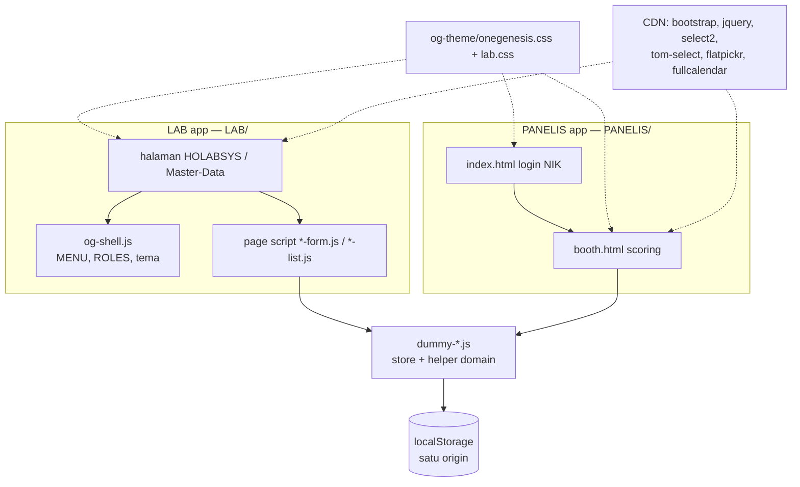
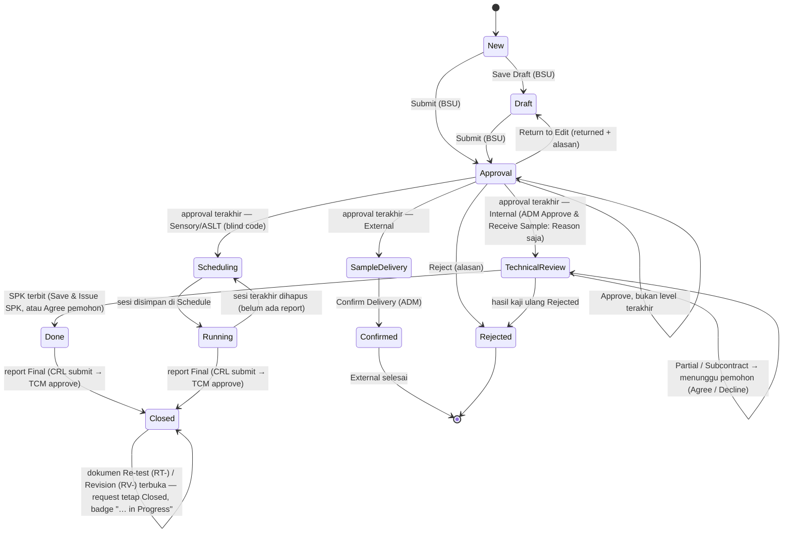
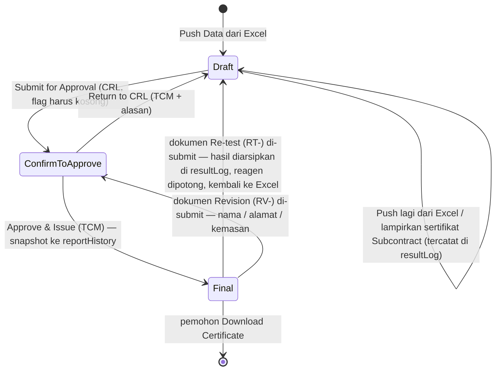
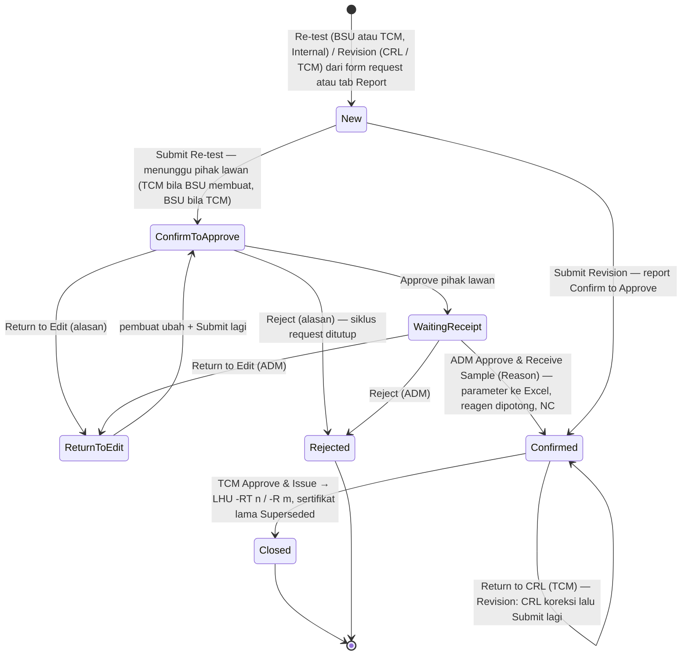
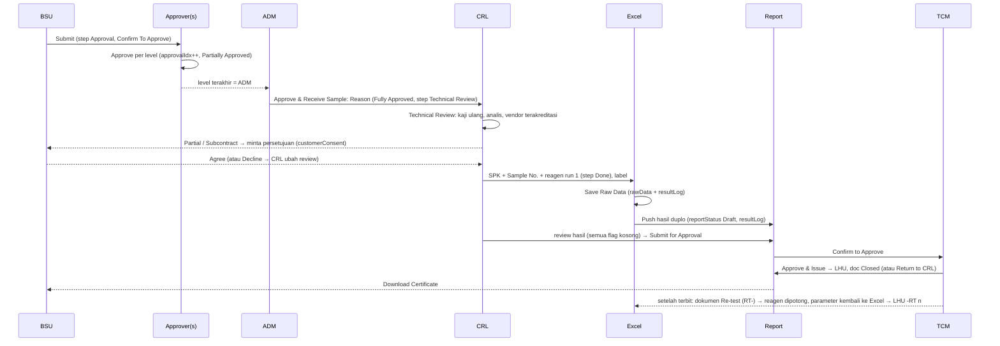
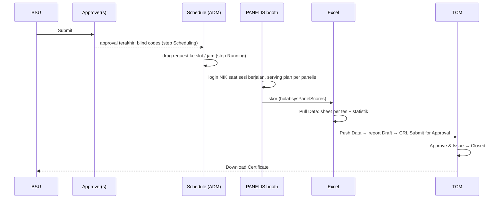
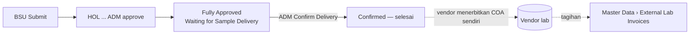

# Flowchart HOLABSYS

Diagram Mermaid untuk `FLOW.md` dan `ARCHITECTURE.md`. Kalau diagram dan teksnya berbeda, teks +
kodenya yang benar. Label transisi = nilai `step` yang ditulis ke record.

## 1. Lapis aplikasi

## 2. Status dokumen (semua jenis)

`getDocStatus()` memetakan: Approval → Confirm to Approve / Partially Approved;
SampleReceipt, TechnicalReview, SampleDelivery & Scheduling → Fully Approved + badge workflow
(TechnicalReview dengan `consentPending` → "Waiting for Requester Approval"); Done / Running / Confirmed /
→ Confirmed (+ badge "Waiting for Report Approval"); `reportStatus: 'Final'` → Closed; dokumen RT- / RV-
terbuka → Closed + badge "Re-test in Progress" / "Revision in Progress". Detail report: §2a, dokumen
Re-test / Revision: §2b.

## 2a. Report (LHU / COA) — satu jalur untuk setiap versi

Selama dokumen Re-test / Revision terbuka, sertifikat terakhir yang terbit tetap berlaku dan bisa
di-download; versi barunya dikerjakan di tab Report dokumen itu.

## 2b. Dokumen Re-test (RT-) / Revision (RV-) — hanya setelah sertifikat terbit

Satu dokumen terbuka per request. Request tetap Closed, list Internal / ASLT and Sensory
menampilkan dokumennya sebagai accordion di bawah request, dan form request + dokumen punya
sidebar Document Journey (Request → RT- → RV- …).

## 3. Internal end-to-end

## 4. Sensory / ASLT end-to-end

## 5. External

